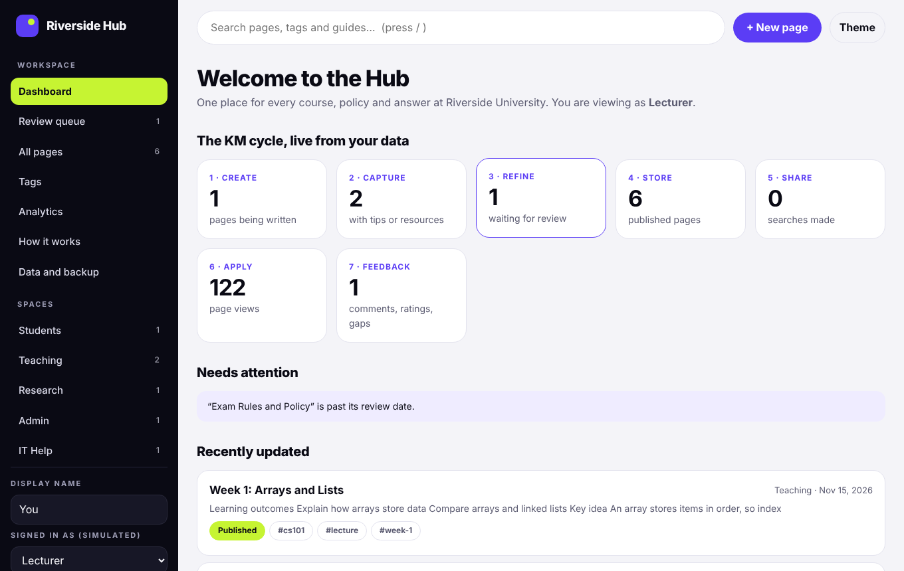
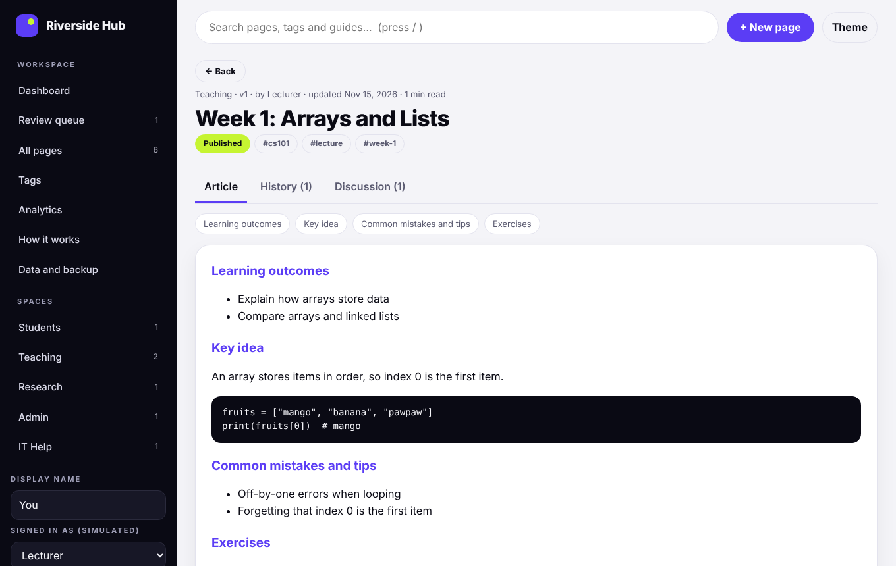
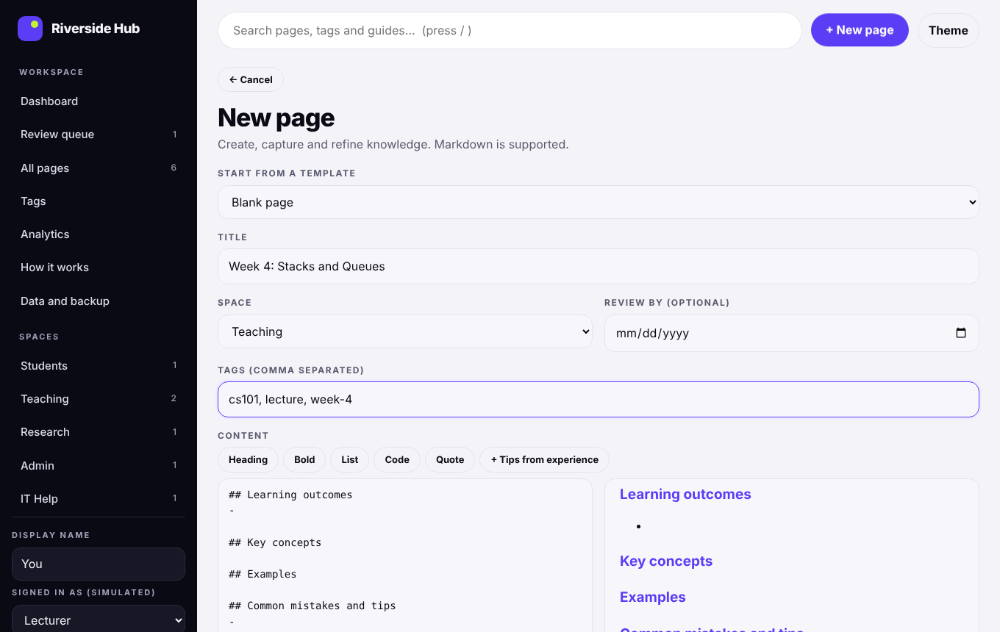
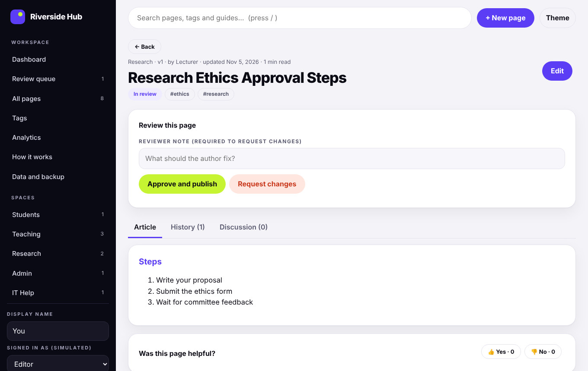
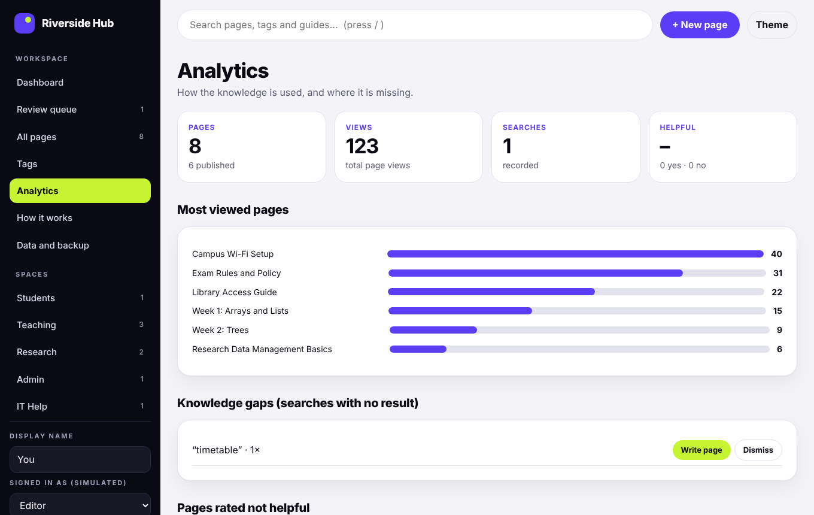
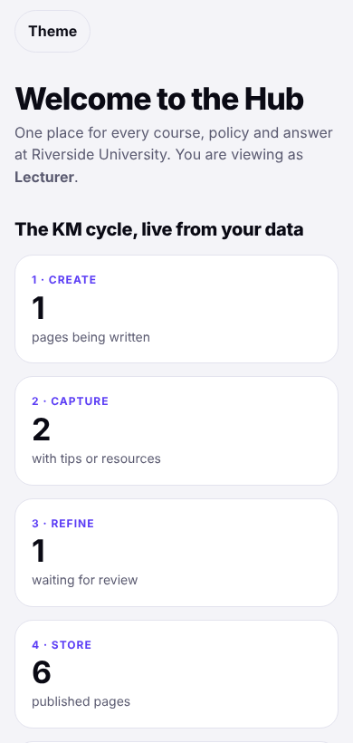

# Riverside Knowledge Hub

A clean, modern, role-based **knowledge management system (KMS)** that demonstrates the full **KM cycle** (create, capture, refine, store, share, apply, feedback) for a university. It runs in any browser with **no build step and no server**, and it ships with unit tests, documentation and a real **Wiki.js** deployment for comparison.

> Built for the *Knowledge Management Systems* creative assignment. The studied open-source KMS is **[Wiki.js](https://js.wiki)**. This repository contains (1) a ready-to-run Wiki.js deployment and (2) the **Riverside Hub**, a lightweight prototype that shows the same KM concepts in a working application.



## Features

| Area | What you can do |
|---|---|
| **Create** | Markdown editor with live preview, formatting toolbar and templates (course page, policy, how-to, lesson learned) |
| **Capture** | "Tips from experience" sections for tacit knowledge, plus resources and links for explicit knowledge |
| **Refine** | Review queue, approve or request changes with a note, full version history with restore |
| **Store** | Spaces, tags, review-by dates with "Review due" flags, role-based permissions |
| **Share** | Ranked full-text search, tag browsing, table of contents and reading time on every page |
| **Apply** | Clean reading view, view counts, print-friendly layout |
| **Feedback** | Comments, change requests, "Was this page helpful?" votes, knowledge-gap tracking from failed searches |
| **Insight** | Live KM-cycle dashboard and analytics (most viewed pages, gaps, helpful rate) |
| **Platform** | Light, dark and automatic themes, responsive layout, keyboard shortcuts, accessible markup, JSON backup and restore |

## Screenshots

| Reading a page | Writing a page |
|---|---|
|  |  |

| Review workflow | Analytics and knowledge gaps |
|---|---|
|  |  |



## Quick start

**Option 1: open the file.** Double-click `index.html`. Click **Load sample content** on the dashboard.

**Option 2: local server.**

```bash
npm start          # serves the folder with `npx serve`
```

**Option 3: GitHub Pages.** Push to `main`. The included workflow (`.github/workflows/pages.yml`) publishes the site. In your repository go to *Settings > Pages* and choose **GitHub Actions** as the source.

## Try the workflow (3 minutes)

1. Load the sample content. You start as a **Lecturer**.
2. Click **+ New page**, pick a template, write a page and press **Submit for review**.
3. Switch the role (bottom left) to **Editor**, open the page and **Request changes** with a note.
4. Switch back to **Lecturer**, edit, resubmit. As **Editor**, **Approve and publish**.
5. Switch to **Student**. Search, read, rate the page and leave a comment.
6. Search for something that does not exist, then open **Analytics** as Editor to see the knowledge gap.

## Roles

| Capability | Student | Lecturer | Editor | Admin |
|---|:-:|:-:|:-:|:-:|
| Read, search, comment, rate | ✓ | ✓ | ✓ | ✓ |
| Write drafts, submit for review | – | ✓ | ✓ | ✓ |
| Approve, publish, restore versions | – | – | ✓ | ✓ |
| Analytics | – | – | ✓ | ✓ |
| Delete pages, erase data | – | – | – | ✓ |

> **Important:** roles are **simulated** so the workflow can be demonstrated on one device. Anyone can switch role. A production system needs real authentication.

## Project structure

```
riverside-knowledge-hub/
├── index.html                 App shell
├── assets/
│   ├── css/styles.css         Design system, themes, responsive layout
│   └── js/
│       ├── core.js            Pure logic: markdown, search, KM-cycle stats (unit tested)
│       ├── permissions.js     Role policy (unit tested)
│       ├── store.js           localStorage persistence, import and export
│       ├── sample.js          Sample university content
│       └── app.js             Views and interactions
├── tests/core.test.js         Node test runner suite
├── deploy/wikijs/             docker-compose for a real Wiki.js instance
├── docs/                      Report, presenter guide, user guide, architecture, slides
└── .github/workflows/         CI tests and GitHub Pages deployment
```

## Run the real Wiki.js

```bash
cd deploy/wikijs
docker compose up -d
# open http://localhost:3000 and finish the setup wizard
```

Change the database password in `docker-compose.yml` before using it for anything beyond a classroom demonstration.

## Tests

```bash
npm test
```

Uses the built-in Node.js test runner (Node 18 or newer). No dependencies to install.

## Data and privacy

All content is stored in your browser's `localStorage`. Nothing is sent to a server. Use **Data and backup > Export** to save a JSON backup and **Import** to restore it on another device. Clearing browser data erases the Hub.

## Limitations and roadmap

- Simulated roles and a single-browser data store (no multi-user sync)
- No file uploads (resources are names and links)
- No formal multi-step approval chains or AI search

Ideas for next steps: a small API and database for shared storage, real single sign-on, file attachments, notifications, and AI-assisted search.

## Documentation

- [Assignment report](docs/REPORT.md)
- [Presenter guide and demo script](docs/PRESENTER_GUIDE.md)
- [User guide](docs/USER_GUIDE.md)
- [Architecture](docs/ARCHITECTURE.md)
- [Slide deck (Marp Markdown)](docs/slides.md)

## License

[MIT](LICENSE)
